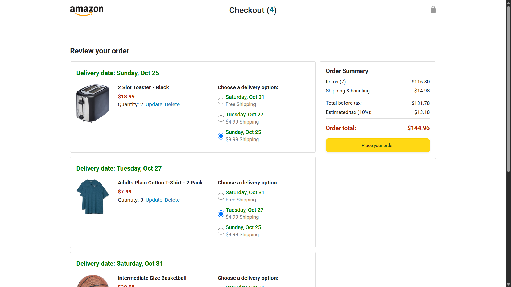
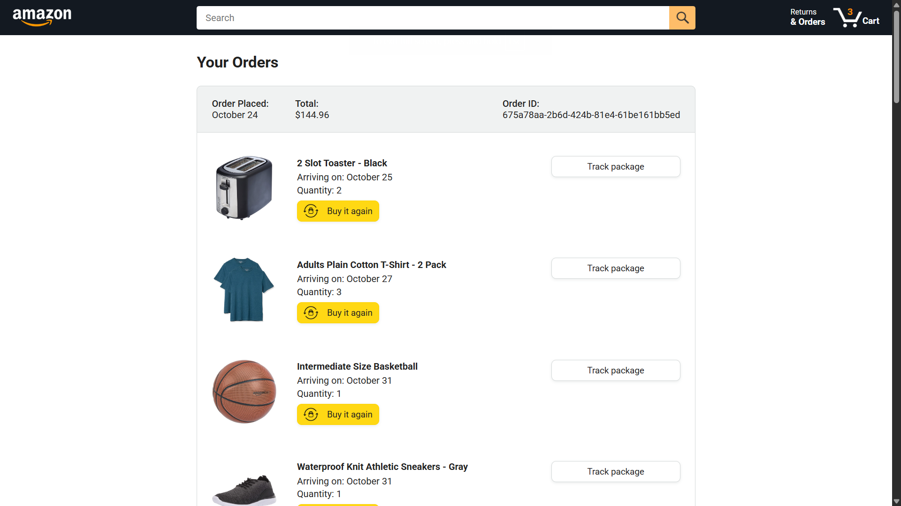

# Amazon Clone (Frontend)

A frontend clone of Amazon's shopping experience, built with **HTML, CSS, and vanilla JavaScript**. I built this while following the SuperSimpleDev JavaScript course to practice core web development concepts.

> **Note:** This project has no real backend. All product data is hardcoded in JavaScript files, so it's meant for learning and demonstration only.

## Screenshots

## Features

- Browse a list of products on the home page
- Add products to the cart with a chosen quantity
- Cart count updates dynamically in the header
- Update or delete items in the cart
- Choose delivery options with calculated delivery dates
- Order summary with item totals, shipping, tax, and final price
- Place an order and view order history
- Cart data saved in the browser using `localStorage`
- Responsive, clean layout styled to resemble Amazon

## Tech Stack

- **HTML5**: page structure
- **CSS3**: styling and layout
- **JavaScript (ES6+)**: DOM manipulation, modules, and application logic
- **Day.js** *(if you used it)*: date handling for delivery estimates

## What I Learned

- Manipulating the DOM with JavaScript
- Generating HTML dynamically from data
- Using `localStorage` to persist data
- Structuring code with ES modules
- Working with dates and calculating prices
- Building layouts with Flexbox and CSS Grid
- Writing cleaner, reusable functions

## Limitations

- No real backend or database; products are hardcoded
- No user authentication or real payments
- Data resets if browser storage is cleared

## Future Improvements

- Connect to a real backend (Node.js/Express and a database)
- Add search and product filtering
- Add user login and signup
- Improve mobile responsiveness

## Acknowledgements

Built by following the [SuperSimpleDev JavaScript Course](https://www.youtube.com/@SuperSimpleDev). All credit for the original concept and guidance goes to the course creator.

## Disclaimer

This is a non-commercial educational project and is not affiliated with Amazon.

## Author

**Deevyank Jain**
[GitHub]((https://github.com/Pixelop888)) | [LinkedIn]((https://www.linkedin.com/in/deevyank-jain-4759a3364/))
